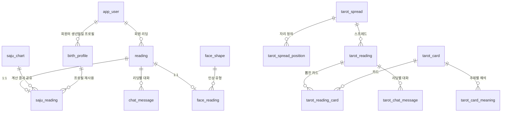

# luck_db 스키마

묘한운세 서비스의 MariaDB 스키마 현황입니다. 실제 DB에서 뽑아 정리했습니다.

- **DB**: `luck_db` · MariaDB 11 · `utf8mb4` / `utf8mb4_unicode_ci` · InnoDB
- **테이블**: 16개
- **적용**: `bash scripts/install.sh`가 `sql/init/*.sql`을 파일명 순서대로 전부 실행합니다. 모두 재실행 안전(`CREATE TABLE IF NOT EXISTS`, `ADD COLUMN IF NOT EXISTS`, UPSERT)이라 몇 번을 돌려도 됩니다.
- **권한**: `luck_user`에게 DDL 권한이 없습니다. 스키마 변경은 반드시 root로 적용하세요.

> 설계 배경과 대안 검토는 [`schema-design.html`](schema-design.html)에 있습니다. 이 문서는 "지금 무엇이 있는가"만 다룹니다.

## 적용 파일

| 파일 | 만드는 것 |
| --- | --- |
| `01_init.sql` | `health_check` |
| `02_tarot.sql` | 타로 테이블 6개 |
| `03_tarot_seed.sql` | 스프레드 3종 + 메이저 아르카나 22장 |
| `04_tarot_meaning_seed.sql` | 주제별 해석 176행 |
| `05_chat_source.sql` | `tarot_chat_message.source` 컬럼 추가 |
| `06_account.sql` | `app_user`, `birth_profile` |
| `07_reading.sql` | `reading`, `chat_message` |
| `08_saju.sql` | `saju_chart`, `saju_reading` |
| `09_face.sql` | `face_shape`, `face_reading` |
| `10_face_seed.sql` | 인상 유형 5종 |

번호 순서가 곧 의존 순서입니다. `05`는 `02`가 만든 테이블을 고치고, `07`은 `06`의 `app_user`를, `08`·`09`는 `07`의 `reading`을 참조하며, `10`은 `09`의 `face_shape`에 데이터를 넣습니다.

## 사용 현황

테이블은 다 있지만 **앱이 실제로 쓰는 것은 타로뿐**입니다.

| 상태 | 테이블 |
| --- | --- |
| 🟢 **운영 중** | `tarot_*` 7개, `health_check` |
| 🟡 **데이터만 있음** | `face_shape` (관상 판정이 아직 브라우저에 있어 서버가 안 읽음) |
| ⚪ **비어 있음** | `app_user`, `birth_profile`, `reading`, `chat_message`, `saju_chart`, `saju_reading`, `face_reading` |

비어 있는 테이블은 로그인·사주 저장·관상 저장을 붙일 때를 대비해 스키마만 미리 만들어 둔 것입니다. 사주·관상은 지금 결과를 그 자리에서 계산해 응답으로 돌려주고 저장하지 않습니다(`app/routers/saju.py`, `app/routers/chat.py`).

---

## 관계도

`tarot_reading`과 `reading`은 지금 **서로 연결되어 있지 않습니다.** 타로는 자체 테이블을 계속 쓰고, `reading`은 비어 있습니다. 사주·관상 저장을 시작할 때 타로를 `reading` 쪽으로 합치는 이관 스크립트가 `sql/migrate/`에 있습니다(자동 실행되지 않음).

---

# 타로 (7)

## `tarot_card` — 카드 카탈로그

메이저 아르카나 22장. 마이너 56장은 아직 없지만 `arcana`/`suit`/`number` 조합으로 78장을 모두 표현할 수 있어 스키마 변경 없이 INSERT만 추가하면 됩니다.

| 컬럼 | 타입 | 설명 |
| --- | --- | --- |
| `id` | `SMALLINT UNSIGNED` PK | |
| `code` | `VARCHAR(16)` UQ | `major-18`, `cups-03` 형태의 고정 식별자 |
| `arcana` | `ENUM('major','minor')` | |
| `suit` | `ENUM('wands','cups','swords','pentacles')` NULL | 메이저는 NULL |
| `number` | `TINYINT UNSIGNED` | 메이저 0–21, 마이너 1–14 (11 페이지·12 나이트·13 퀸·14 킹) |
| `name_ko` / `name_en` | `VARCHAR(40)` | |
| `keyword_upright` / `keyword_reversed` | `VARCHAR(120)` | 쉼표로 구분한 핵심어 |
| `meaning_upright` / `meaning_reversed` | `VARCHAR(500)` | **기본 해석**. 주제별 해석이 없을 때 폴백 |
| `image_path` | `VARCHAR(255)` NULL | `/assets` 기준 상대 경로. 이미지 파일은 아직 없음 |
| `is_active` | `TINYINT(1)` = 1 | |

**유니크**: `code` / `(arcana, suit, number)`

## `tarot_card_meaning` — 주제별 해석

행이 없으면 `tarot_card`의 기본 해석으로 자동 폴백합니다. 주제를 늘릴 때 스키마 변경 없이 INSERT만 하면 되도록 별도 테이블로 두었습니다.

| 컬럼 | 타입 | 설명 |
| --- | --- | --- |
| `id` | `BIGINT UNSIGNED` PK | |
| `card_id` | → `tarot_card.id` | `ON DELETE CASCADE` |
| `topic` | `ENUM('love','career','money','health')` | `general`은 없음 — 그게 카드의 기본 해석 |
| `orientation` | `ENUM('upright','reversed')` | |
| `meaning` | `VARCHAR(500)` | |

**유니크**: `(card_id, topic, orientation)` · 현재 176행 = 22장 × 4주제 × 2방향

## `tarot_spread` — 스프레드 정의

| 컬럼 | 타입 | 설명 |
| --- | --- | --- |
| `id` | `SMALLINT UNSIGNED` PK | |
| `code` | `VARCHAR(32)` UQ | `one-card`, `past-present-future`, `situation-advice` |
| `name_ko` | `VARCHAR(40)` | |
| `description` | `VARCHAR(255)` | |
| `card_count` | `TINYINT UNSIGNED` | 뽑을 장수 |
| `sort_order` | `SMALLINT UNSIGNED` = 0 | 화면 노출 순서 |
| `is_active` | `TINYINT(1)` = 1 | |

## `tarot_spread_position` — 자리 라벨

| 컬럼 | 타입 | 설명 |
| --- | --- | --- |
| `id` | `SMALLINT UNSIGNED` PK | |
| `spread_id` | → `tarot_spread.id` | `ON DELETE CASCADE` |
| `position_no` | `TINYINT UNSIGNED` | 1부터 |
| `label_ko` | `VARCHAR(40)` | 과거 / 현재 / 미래, 상황 / 걸림돌 / 조언 … |
| `description` | `VARCHAR(255)` NULL | |

**유니크**: `(spread_id, position_no)`

## `tarot_reading` — 리딩 1회

| 컬럼 | 타입 | 설명 |
| --- | --- | --- |
| `id` | `BIGINT UNSIGNED` PK | |
| `user_id` | `BIGINT UNSIGNED` NULL | 회원. **FK 없음** — 로그인이 붙으면 `app_user.id` 참조 예정 |
| `guest_key` | `CHAR(36)` NULL | 비회원 식별 UUID. 브라우저가 보관 |
| `spread_id` | → `tarot_spread.id` | |
| `topic` | `ENUM('general','love','career','money','health')` = `general` | |
| `question` | `VARCHAR(255)` NULL | 사용자가 적은 질문 |
| `summary_title` / `summary_text` | `VARCHAR(120)` / `TEXT` NULL | 결과 요약 |
| `interpretation_source` | `ENUM('rule','llm')` = `rule` | 요약을 무엇으로 만들었나 |
| `llm_model` | `VARCHAR(64)` NULL | |
| `status` | `ENUM('drawn','interpreted','failed')` = `drawn` | |

**제약**: `ck_tarot_reading_owner` — `user_id`와 `guest_key` 중 하나는 반드시 있어야 함
**인덱스**: `(user_id, created_at)`, `(guest_key, created_at)` — 마이페이지 목록 조회용

## `tarot_reading_card` — 뽑힌 카드

| 컬럼 | 타입 | 설명 |
| --- | --- | --- |
| `id` | `BIGINT UNSIGNED` PK | |
| `reading_id` | → `tarot_reading.id` | `ON DELETE CASCADE` |
| `position_no` | `TINYINT UNSIGNED` | 스프레드의 자리 번호 |
| `card_id` | → `tarot_card.id` | |
| `orientation` | `ENUM('upright','reversed')` = `upright` | |

**유니크 2개가 규칙을 강제합니다.** `(reading_id, position_no)` — 한 자리에 두 장 불가. `(reading_id, card_id)` — 한 리딩에 같은 카드 중복 불가. 애플리케이션 버그가 있어도 DB가 막습니다.

## `tarot_chat_message` — 결과 화면 대화

| 컬럼 | 타입 | 설명 |
| --- | --- | --- |
| `id` | `BIGINT UNSIGNED` PK | |
| `reading_id` | → `tarot_reading.id` | `ON DELETE CASCADE` |
| `seq` | `SMALLINT UNSIGNED` | 리딩 내 순번, 1부터 |
| `role` | `ENUM('system','user','assistant')` | |
| `content` | `TEXT` | |
| `source` | `ENUM('rule','llm')` NULL | assistant 답변을 무엇으로 만들었나. user/system은 NULL |

**유니크**: `(reading_id, seq)`

---

# 계정 (2) — 비어 있음

로그인 기능이 아직 없습니다. 로그인 페이지를 만들 때 맞춰볼 테이블로 미리 만들어 두었습니다.

## `app_user`

| 컬럼 | 타입 | 설명 |
| --- | --- | --- |
| `id` | `BIGINT UNSIGNED` PK | |
| `email` | `VARCHAR(190)` UQ | utf8mb4 인덱스 키 길이(767바이트) 때문에 190자 |
| `password_hash` | `VARCHAR(255)` NULL | 소셜 로그인만 쓰면 NULL |
| `nickname` | `VARCHAR(40)` | |
| `status` | `ENUM('active','dormant','withdrawn')` = `active` | 탈퇴해도 행을 지우지 않고 익명화할 여지를 남김 |

## `birth_profile` — 사주용 생년월일 프로필

한 회원이 여러 개(본인·가족)를 가질 수 있습니다.

| 컬럼 | 타입 | 설명 |
| --- | --- | --- |
| `id` | `BIGINT UNSIGNED` PK | |
| `user_id` | → `app_user.id` | `ON DELETE CASCADE` |
| `label` | `VARCHAR(40)` | `내 사주`, `엄마` … |
| `birth_date` | `DATE` | |
| `birth_time` | `TIME` NULL | **NULL은 "모른다"는 뜻.** 정오로 대체한 값이 아님 |
| `calendar` | `ENUM('solar','lunar','lunar_leap')` = `solar` | |
| `gender` | `ENUM('female','male','unknown')` = `unknown` | |

---

# 공통 리딩 (2) — 비어 있음

사주·관상·타로가 **함께 쓸** 뼈대입니다. 마이페이지가 테이블 하나만 읽으면 세 기능 기록이 모두 나오게 하는 것이 목적입니다.

## `reading`

| 컬럼 | 타입 | 설명 |
| --- | --- | --- |
| `id` | `BIGINT UNSIGNED` PK | |
| `service` | `ENUM('saju','face','tarot')` | 어느 기능의 리딩인가 |
| `user_id` | → `app_user.id` NULL | FK 있음 (`RESTRICT`) |
| `guest_key` | `CHAR(36)` NULL | 비회원 식별자 |
| `summary_title` / `summary_text` | `VARCHAR(120)` / `TEXT` NULL | |
| `interpretation_source` | `ENUM('rule','llm')` = `rule` | |
| `llm_model` | `VARCHAR(64)` NULL | |
| `status` | `ENUM('created','interpreted','failed')` = `created` | |

**제약**: `ck_reading_owner` — `user_id`/`guest_key` 중 하나 필수
**인덱스**: `(user_id, created_at)`, `(guest_key, created_at)`

> `user_id`의 FK를 `ON DELETE SET NULL`로 걸 수 없습니다. MariaDB는 `SET NULL` FK가 걸린 컬럼에 CHECK 제약을 허용하지 않습니다(ERROR 1901). 그래서 기본값(RESTRICT)으로 두었고, 탈퇴는 `app_user.status = 'withdrawn'`으로 처리합니다.

## `chat_message`

`tarot_chat_message`와 구조가 같지만 `reading`에 붙습니다. 관상 채팅이 여기 저장되면 지금처럼 매 요청마다 컨텍스트를 통째로 재전송할 필요가 없어지고, 질문 5회 제한도 서버가 셀 수 있습니다.

| 컬럼 | 타입 | 설명 |
| --- | --- | --- |
| `id` | `BIGINT UNSIGNED` PK | |
| `reading_id` | → `reading.id` | `ON DELETE CASCADE` |
| `seq` | `SMALLINT UNSIGNED` | |
| `role` | `ENUM('system','user','assistant')` | |
| `content` | `TEXT` | |
| `source` | `ENUM('rule','llm')` NULL | |

**유니크**: `(reading_id, seq)`

---

# 사주 (2) — 비어 있음

## `saju_chart` — 계산 결과

사주는 같은 생년월일시·성별이면 **언제 계산해도 결과가 같습니다.** 리딩마다 복사하지 않고 여기 한 번 계산해 두고 참조합니다.

| 컬럼 | 타입 | 설명 |
| --- | --- | --- |
| `id` | `BIGINT UNSIGNED` PK | |
| `birth_date` | `DATE` | |
| `birth_time` | `TIME` NULL | |
| `time_unknown` | `TINYINT(1)` = 0 | |
| `gender` | `ENUM('female','male','unknown')` | |
| `engine_version` | `VARCHAR(32)` | `korean-saju` 버전 |
| `pillar_year` / `pillar_month` / `pillar_day` | `CHAR(2)` | 갑자 두 글자 |
| `pillar_hour` | `CHAR(2)` NULL | 시각을 모르면 NULL |
| `jeonggyeok` / `yongsin` | `VARCHAR(40)` NULL | |
| `sinsal` | `JSON` NULL | 개수가 유동적이라 JSON. 조회가 필요해지면 별도 테이블로 펴면 됨 |

**유니크**: `(birth_date, birth_time, time_unknown, gender, engine_version)`

> `engine_version`을 유니크 키에 넣은 이유는 `korean-saju`가 올라가 계산이 달라져도 **과거 리딩이 그때 보여준 결과를 그대로 유지**하기 위해서입니다. 새 버전은 새 행이 됩니다.
>
> 네 기둥을 한 문자열이 아니라 **기둥별로 쪼갠 이유**는 "월주가 무엇인 사람" 같은 조회가 나중에 반드시 나오기 때문입니다.

## `saju_reading`

| 컬럼 | 타입 | 설명 |
| --- | --- | --- |
| `reading_id` | PK, → `reading.id` | `ON DELETE CASCADE`. **PK가 곧 FK라 1:1이 스키마로 강제됨** |
| `chart_id` | → `saju_chart.id` | |
| `birth_profile_id` | → `birth_profile.id` NULL | 비회원이면 NULL. `ON DELETE SET NULL` |
| `topic` | `ENUM('general','love','career','money','health')` = `general` | 타로와 같은 값 — 주제 선택 UI를 공유할 수 있음 |
| `question` | `VARCHAR(255)` NULL | |

---

# 관상 (2)

## `face_shape` — 인상 유형 (5행, 앱은 아직 안 읽음)

`src/features/face-reading/interpretation/faceReadingRules.js`의 `shapeReadings`가 원본입니다. `code`는 `classifyFaceShape()`가 돌려주는 값과 정확히 같아야 합니다 — `하트형`, `각진형`, `둥근형`, `긴 타원형`, `균형형`.

| 컬럼 | 타입 | 설명 |
| --- | --- | --- |
| `id` | `SMALLINT UNSIGNED` PK | |
| `code` | `VARCHAR(32)` UQ | |
| `title` | `VARCHAR(80)` | |
| `keyword` | `VARCHAR(40)` | |
| `summary` | `VARCHAR(500)` | |
| `is_active` | `TINYINT(1)` = 1 | |

## `face_reading` — 측정값 (비어 있음)

**사진도, 랜드마크 468점 좌표도 저장하지 않습니다.** 결과 문구를 다시 만드는 데 필요한 건 비율 여섯 개와 사용자가 고른 `mood`뿐입니다. 얼굴형은 `aspect`/`jaw`/`forehead` 세 비율에서 파생되므로 따로 저장하지 않습니다.

| 컬럼 | 타입 | 설명 |
| --- | --- | --- |
| `reading_id` | PK, → `reading.id` | `ON DELETE CASCADE` |
| `shape_id` | → `face_shape.id` NULL | |
| `aspect_ratio` | `DECIMAL(5,4)` | 얼굴 세로/가로 |
| `jaw_ratio` / `forehead_ratio` / `eye_ratio` / `mouth_ratio` | `DECIMAL(5,4)` | 전부 얼굴 폭 대비 |
| `symmetry_score` | `DECIMAL(5,4)` | 좌우 대칭. 결과 문장은 `harmonyReading()`이 만듦 |
| `mood` | `VARCHAR(20)` NULL | 사용자가 고른 첫인상 키워드 |
| `detector_version` | `VARCHAR(32)` | MediaPipe 모델 버전 |
| `coverage` / `roll_degrees` / `nose_offset` | `DECIMAL` NULL | 촬영 품질 지표(`validateFacePose`). 결과에 영향 없음 |

> `FLOAT`이 아니라 `DECIMAL`을 쓴 이유는 판정 경계값(`eyeRatio >= 0.205`, `jawRatio > 0.91`)과 정확히 비교하기 위해서입니다.
>
> `detector_version`은 `saju_chart.engine_version`과 같은 목적입니다. 모델이 바뀌면 같은 사진도 다른 숫자가 나오므로, 과거 결과를 해석할 때 무엇으로 쟀는지 알아야 합니다.

---

# 기타

## `health_check`

`GET /health`가 DB 연결을 확인할 때 읽습니다.

| 컬럼 | 타입 |
| --- | --- |
| `id` | `INT` PK |
| `status` | `VARCHAR(32)` |
| `checked_at` | `TIMESTAMP` |

---

## 앞으로 정해야 할 것

- **로그인을 실제로 붙일지** — 안 붙이면 `app_user`, `birth_profile`, `reading.user_id`는 계속 비어 있습니다
- **사주·관상 결과를 저장할지** — 마이페이지 다시보기와 채팅 기록이 필요해지는 시점입니다
- **관상 판정을 서버로 옮길지** — `face_shape`는 그 전제 위에 있습니다
- **비회원 기록 보관 기간** — `guest_key` 리딩은 주인이 브라우저를 지우면 영영 접근 불가인 채 계속 쌓입니다
- **타로를 `reading` 구조로 이관할지** — 스크립트는 `sql/migrate/`에 준비되어 있습니다
